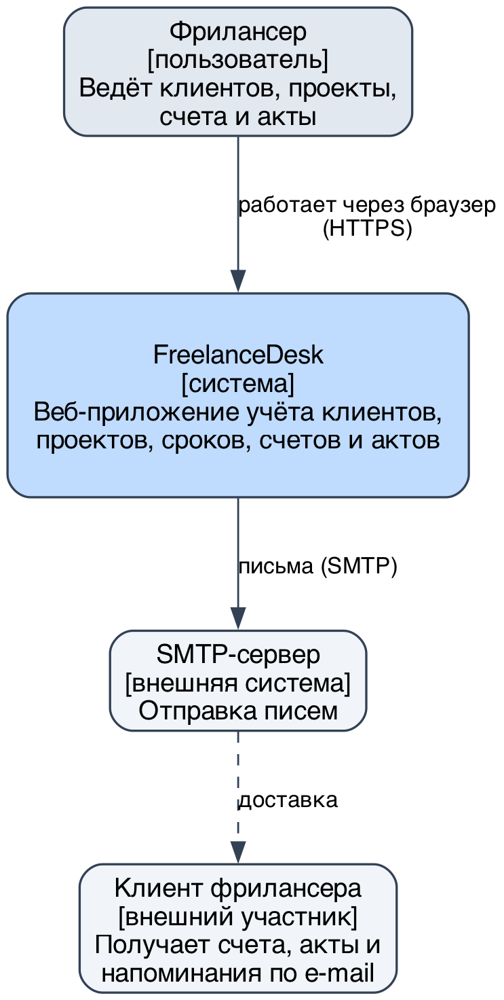
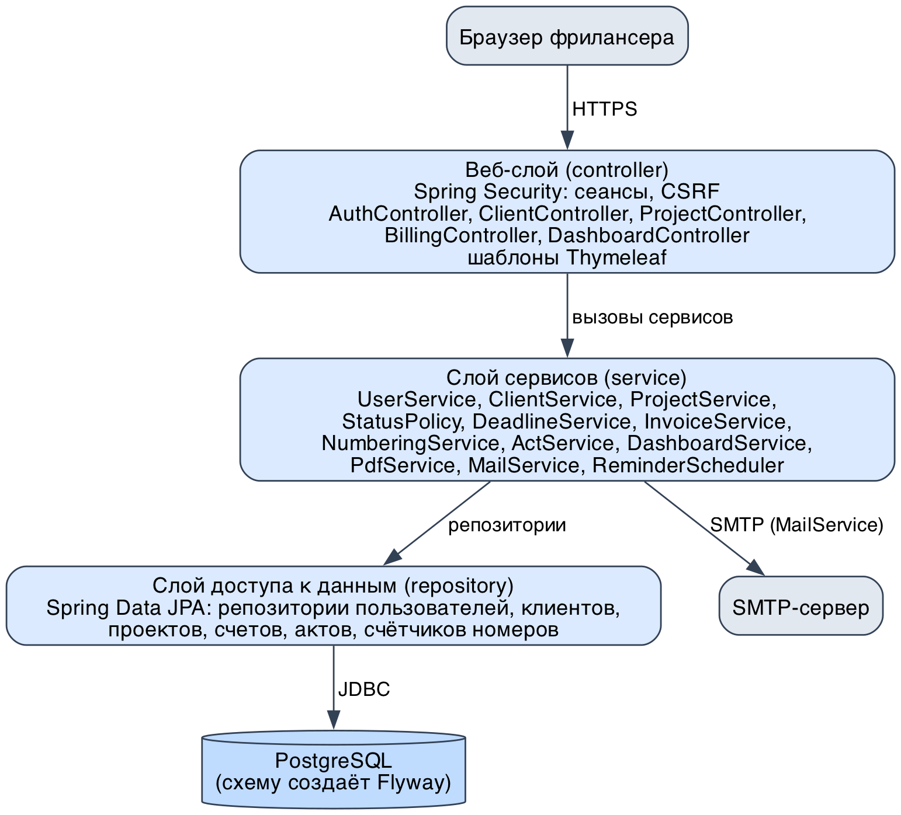
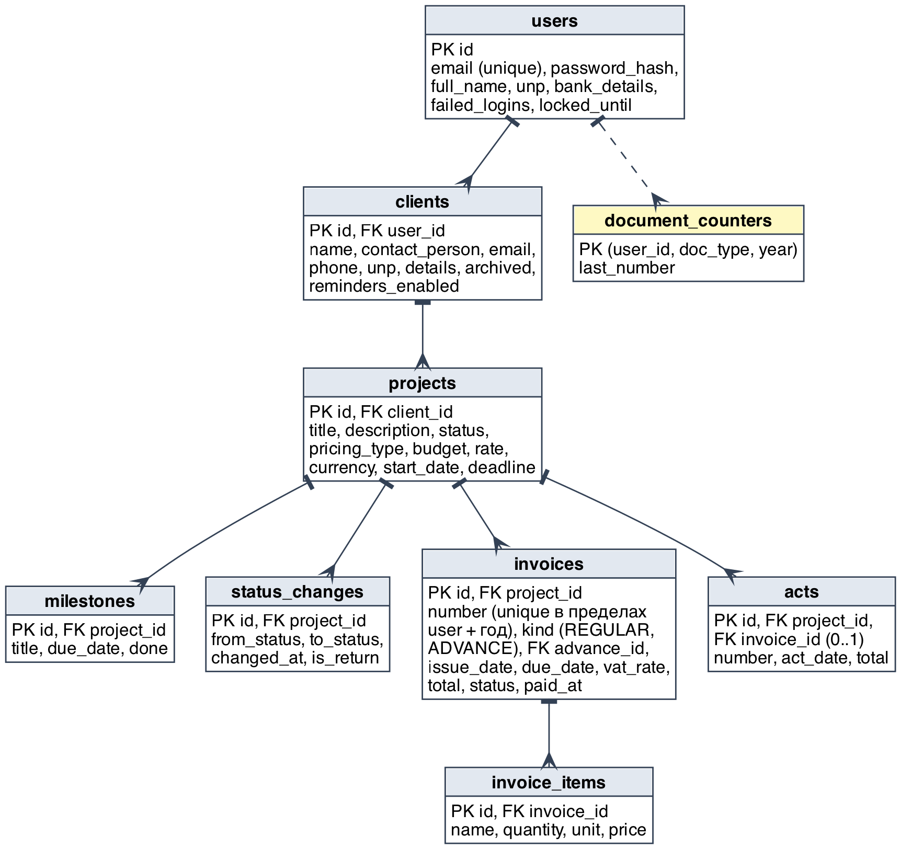
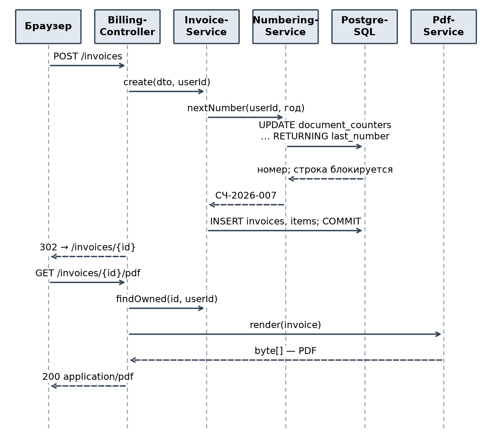
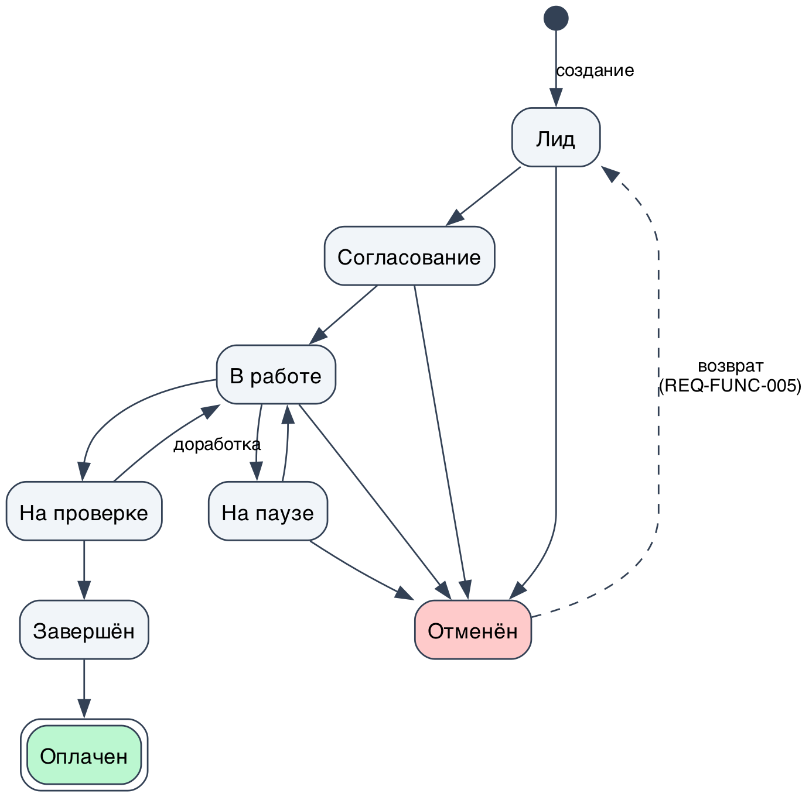
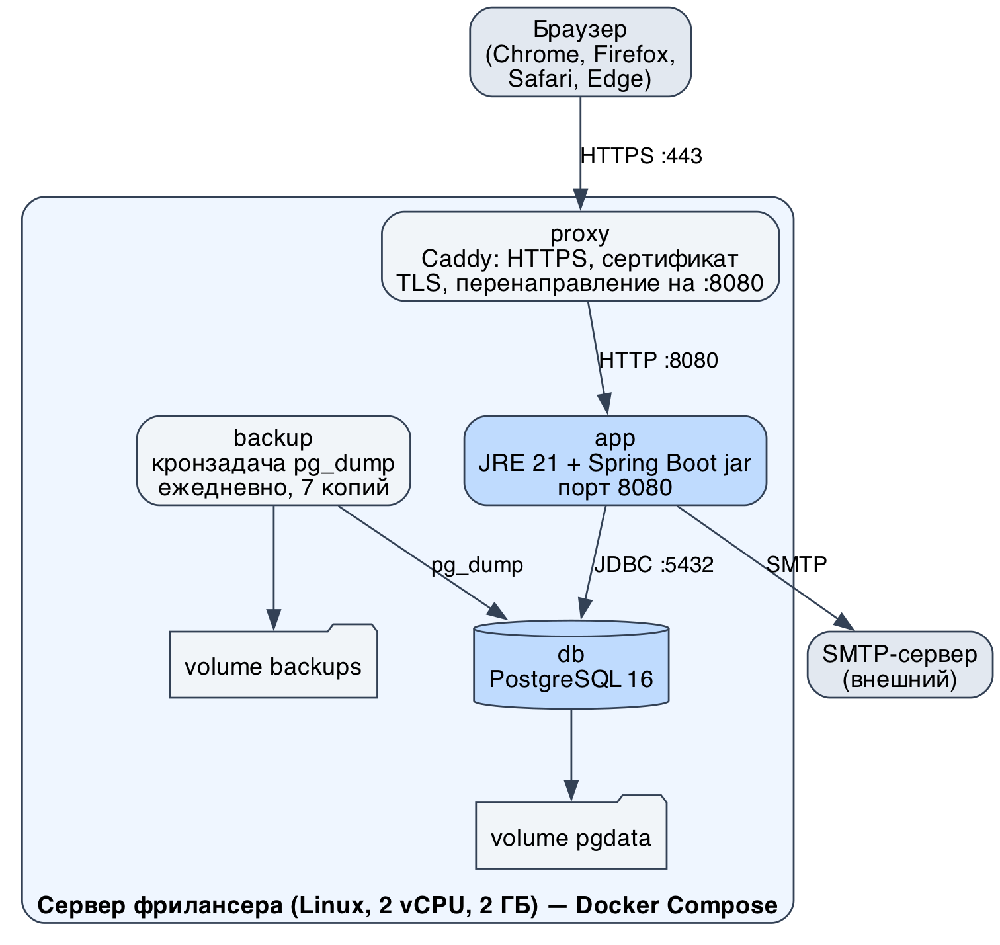

# Описание дизайна программного обеспечения

Для **FreelanceDesk** — CRM-трекера для фрилансера с управлением проектами

Версия 0.3

Подготовил Могильный В. А., группа 450503

Белорусский государственный университет информатики и радиоэлектроники, кафедра электронных вычислительных машин

{{дата}}

## Оглавление

* [1. Введение](#1-введение)
* [2. Обзор дизайна](#2-обзор-дизайна)
* [3. Проектные представления](#3-проектные-представления)
* [4. Решения](#4-решения)
* [5. Приложения](#5-приложения)

## История изменений

| Name | Date | Reason For Changes | Version |
|------|------|--------------------|---------|
| Могильный В. А. | {{дата}} | Первая версия на основе SRS 0.2: контекст, композиция, логическое и информационное представления, развёртывание, ADR 0001–0006 | 0.1 |
| Могильный В. А. | {{дата}} | По итогам первого раунда обсуждения с заказчиком: функции приоритета 40–50 вынесены в версию 1.1 (доска статусов, отправка документов, напоминание клиенту, выгрузка CSV, журнал взаимодействий); упрощены нефункциональные работы W-4…W-6 (см. план v2); напоминания о сроках (REQ-FUNC-015) повышены до приоритета 20 | 0.2 |
| Могильный В. А. | {{дата}} | По итогам второго раунда: добавлена функция REQ-FUNC-019 «Счёт на предоплату», изменены информационное представление и взаимодействие, добавлен ADR 0007 | 0.3 |

---

## 1. Введение

Документ описывает, **как** будет построено веб-приложение FreelanceDesk, требования к которому зафиксированы в `srs/srs.md` (версия 0.4). Раздел 2 определяет задачи заинтересованных сторон и выбранные точки зрения, раздел 3 содержит проектные представления, раздел 4 — перечень архитектурных решений (полные записи — в каталоге `adr/`), раздел 5 — приложения.

### 1.1 Назначение документа

SDD предназначен для разработчиков (исполнитель и подключаемый junior-разработчик), которые по нему реализуют итерации, для заказчика, который проверяет, что проектные решения не противоречат его ожиданиям по срокам и стоимости, и для рецензента. Документ опирается на SRS (что должна делать система) и ссылается на записи архитектурных решений ADR (почему выбрано именно так).

### 1.2 Область применения

Проектируется FreelanceDesk версии 1.0: веб-приложение для одного пользователя на учётную запись (фрилансер) с учётом клиентов, проектов, статусов и сроков, счетов и актов в PDF, дашбордом и напоминаниями. В версию 1.0 по результатам согласования входят требования, перечисленные в плане (`plan/plan.md`, версия v3); требования приоритета 40–50 (доска статусов, журнал взаимодействий, отправка документов и напоминание клиенту, выгрузка в CSV) проектируются в SDD только на уровне точек расширения и войдут в версию 1.1.

Вне области проектирования: личный кабинет клиента, онлайн-оплата, мобильное приложение, учёт времени, интеграция с бухгалтерскими системами (см. SRS, раздел 1.2).

### 1.3 Определения, акронимы и сокращения

| Term | Definition |
|------|------------|
| ADR | Architecture Decision Record — запись архитектурного решения |
| DAO / репозиторий | Слой доступа к данным, скрывающий детали хранения |
| JPA | Jakarta Persistence API — стандарт объектно-реляционного отображения |
| MVC | Model–View–Controller — шаблон разделения модели, представления и управления |
| SSR | Server-Side Rendering — формирование HTML на сервере |
| Flyway | Инструмент версионных миграций схемы базы данных |
| Thymeleaf | Серверный шаблонизатор HTML для Spring MVC |
| OpenPDF | Библиотека формирования PDF на Java (LGPL/MPL) |
| Counter | Таблица `document_counters`, хранящая последний выданный номер документа |
| SDD | Software Design Description — описание дизайна ПО |

### 1.4 Ссылки

| Источник | Тип | Расположение |
|----------|-----|--------------|
| Спецификация требований FreelanceDesk, версия 0.4 | нормативная | `srs/srs.md` |
| IEEE 1016-2009. Systems design — Software design descriptions | справочная | — |
| ISO/IEC/IEEE 42010:2011. Architecture description | справочная | — |
| MADR 4.0 — Markdown Architectural Decision Records | справочная | `adr/adr-template.md` |
| Шаблон SDD кафедры ЭВМ БГУИР | нормативная | `sdd/sdd-template.md` |
| Записи архитектурных решений ADR 0001–0007 | нормативная | `adr/` |
| План реализации и оценки | справочная | `plan/plan.md` |
| Переписка с заказчиком | справочная | `plan/correspondence.md` |

### 1.5 Обзор документа

Раздел 2 связывает интересы сторон с точками зрения, раздел 3 даёт представления с идентификаторами вида `[ННН]-название` и ссылками на требования SRS, раздел 4 перечисляет решения со ссылками на файлы ADR. Каждое изменение документа записывается в историю изменений и повышает версию.

---

## 2. Обзор дизайна

Система проектируется как **модульный монолит**: одно приложение на Java 21 и Spring Boot, разделённое на три слоя (web – service – repository), с одной реляционной базой данных. Выбор обоснован ограничением по бюджету и срокам (REQ-COST-001, REQ-DEAD-001) и единственным пользователем одной установки (ADR 0001). Страницы формируются на сервере (ADR 0002), что исключает отдельное клиентское приложение и сокращает объём работ на итерациях.

### 2.1 Задачи стейкхолдеров

| Стейкхолдер | Основные задачи | Точки зрения |
|-------------|-----------------|--------------|
| Фрилансер (пользователь) | Не терять сроки и счета; быстро оформлять документы; сохранность данных | Контекст, Информация, Взаимодействие, Динамика состояний |
| Заказчик (проверяющий проект) | Срок и стоимость; соответствие требованиям | Композиция, Ресурсы, Развёртывание |
| Разработчики | Понятное разделение работ, независимые модули для junior, тестируемость | Композиция, Логическое, Интерфейс, Паттерны |
| Оператор развёртывания | Простая установка, резервные копии, журналы | Развёртывание, Ресурсы |

### 2.2 Выбранные точки зрения

Из пятнадцати точек зрения шаблона выбраны девять, остальные не нужны по масштабу системы.

| Точка зрения | Адресует | Язык | Представление |
|--------------|----------|------|---------------|
| Контекст | Границы системы, участники | Контекстная диаграмма C4 | 001-context |
| Композиция | Слои, модули, внешние зависимости | Диаграмма компонентов | 002-composition |
| Логическое | Основные классы и ответственность | Таблица классов | 003-logical |
| Информация | Структура хранимых данных | Диаграмма «сущность–связь» | 004-information |
| Интерфейс | Маршруты и внешние контракты | Таблица маршрутов | 005-interface |
| Взаимодействие | Порядок вызовов при создании счёта и PDF | Диаграмма последовательности | 006-interaction |
| Динамика состояний | Статусы проекта | Диаграмма состояний | 007-state |
| Паттерны | Применяемые шаблоны проектирования | Таблица | 008-patterns |
| Развёртывание | Контейнеры и узлы | Диаграмма развёртывания | 009-deployment |

Точки зрения «Физическое представление», «Структура», «Зависимости», «Алгоритм», «Параллелизм», «Ресурсы» отдельных представлений не получили: топология сводится к одному серверу (входит в 009), алгоритмы и параллелизм нумерации описаны в ADR 0005, ресурсные ограничения — в REQ-PERF-001 и REQ-COST-001.

---

## 3. Проектные представления

### 001-context. Контекст

- **Viewpoint**: Контекст
- **Representation**: система FreelanceDesk взаимодействует с одним активным участником — фрилансером (через браузер по HTTPS) — и одной внешней системой — SMTP-сервером, который доставляет письма клиентам фрилансера. Клиент в системе не работает и получает только PDF-документы и напоминания (рисунок 1).

- **More Information**: SRS, рисунок 1; REQ-INT-003; ADR 0001.

### 002-composition. Композиция

- **Viewpoint**: Композиция
- **Representation**: приложение разделено на три слоя; зависимости направлены только вниз (рисунок 2). Веб-слой принимает запросы, проверяет вход и права (Spring Security), вызывает сервисы и формирует HTML (Thymeleaf). Слой сервисов содержит бизнес-правила: допустимость переходов статусов (`StatusPolicy`), расчёт сроков (`DeadlineService`), создание счетов и актов, нумерацию, формирование PDF, рассылку писем. Слой доступа к данным состоит из репозиториев Spring Data JPA. Пакеты Java: `by.bsuir.freelancedesk.{web, service, repository, domain, config}`.

- **More Information**: REQ-MAINT-001; ADR 0001, 0002; модули `PdfService` и `MailService` изолированы за интерфейсами для замены библиотеки (SRS, 3.5.5).

### 003-logical. Логическое представление

- **Viewpoint**: Логическое
- **Representation**: ключевые классы и их ответственность.

| Класс | Слой | Ответственность | Требования |
|-------|------|-----------------|------------|
| `User` | domain | Учётная запись, реквизиты фрилансера, счётчик неудачных входов | REQ-FUNC-001, REQ-SEC-004 |
| `Client` | domain | Карточка клиента, признак архивирования | REQ-FUNC-002 |
| `Project`, `Milestone`, `StatusChange` | domain | Проект, этапы, история статусов | REQ-FUNC-004, 005, 006 |
| `Invoice`, `InvoiceItem`, `Act` | domain | Финансовые документы, итоговая сумма | REQ-FUNC-010, 011, 013, 019 |
| `StatusPolicy` | service | Таблица допустимых переходов статусов; единственное место правил | REQ-FUNC-005 |
| `DeadlineService` | service | Определение «просрочен» и «приближается» | REQ-FUNC-007 |
| `NumberingService` | service | Выдача уникального номера документа | REQ-REL-002 |
| `InvoiceService`, `ActService` | service | Создание, редактирование черновика, выставление, оплата | REQ-FUNC-010, 011, 013, 019 |
| `PdfService` | service | Преобразование документа в PDF (интерфейс + реализация OpenPDF) | REQ-FUNC-012, REQ-INT-002 |
| `DashboardService` | service | Агрегаты для главной страницы | REQ-FUNC-008 |
| `ReminderScheduler`, `MailService` | service | Ежедневное напоминание о сроках; отправка писем | REQ-FUNC-015, REQ-INT-003 |

- **More Information**: модель данных — представление 004.

### 004-information. Информация

- **Viewpoint**: Информация
- **Representation**: данные хранятся в PostgreSQL; схема создаётся миграциями Flyway (`V1__init.sql`, далее по одной миграции на изменение). Основные таблицы и связи показаны на рисунке 3. Идентификаторы — `bigint` с последовательностями; суммы — `numeric(12,2)`; даты — `date`, моменты времени — `timestamptz`. Каждая запись клиента, проекта, счёта и акта принадлежит пользователю через цепочку внешних ключей; репозитории всегда фильтруют по `user_id` (REQ-SEC-002). Таблица `document_counters` хранит последний выданный номер по ключу «пользователь – тип документа – год» (ADR 0005). Авансовый счёт (REQ-FUNC-019) хранится в той же таблице `invoices` с `kind = 'ADVANCE'`; итоговый счёт ссылается на него полем `advance_id` и уменьшает сумму к оплате (ADR 0007).

- **More Information**: SRS, приложение Б; REQ-INT-004, REQ-REL-002, REQ-COMP-001; ADR 0003, 0005, 0007.

### 005-interface. Интерфейс

- **Viewpoint**: Интерфейс
- **Representation**: внешний интерфейс — HTML-страницы и PDF-файлы по HTTPS; REST API не предоставляется. Основные маршруты:

| Маршрут | Метод | Назначение | Требование |
|---------|-------|------------|------------|
| `/register`, `/login`, `/logout` | GET, POST | Регистрация и вход | REQ-FUNC-001 |
| `/clients`, `/clients/{id}` | GET, POST | Список, карточка, изменение, архивирование | REQ-FUNC-002, 003 |
| `/projects`, `/projects/{id}` | GET, POST | Проекты, статусы, этапы | REQ-FUNC-004–007 |
| `/projects/{id}/status` | POST | Смена статуса с проверкой `StatusPolicy` | REQ-FUNC-005 |
| `/invoices`, `/invoices/{id}` | GET, POST | Создание, выставление, оплата счёта | REQ-FUNC-010, 013, 019 |
| `/invoices/{id}/pdf`, `/acts/{id}/pdf` | GET | Выгрузка PDF | REQ-FUNC-012 |
| `/acts` | GET, POST | Создание акта из счёта или проекта | REQ-FUNC-011 |
| `/` | GET | Дашборд | REQ-FUNC-008 |
| `/actuator/health` | GET | Проверка состояния | REQ-OBS-001 |

Внутренние контракты — интерфейсы `PdfService.render(Document)` и `MailService.send(Message)`. Исходящий интерфейс — SMTP (адрес, порт, логин, пароль, шифрование из переменных окружения).

- **More Information**: ADR 0002; REQ-INT-001–003.

### 006-interaction. Взаимодействие

- **Viewpoint**: Взаимодействие
- **Representation**: сценарий «создание счёта и выгрузка PDF» показан на рисунке 4. Номер выдаётся внутри транзакции создания счёта: строка счётчика блокируется оператором `UPDATE … RETURNING`, поэтому параллельные запросы получают разные номера и откат транзакции не оставляет пропусков. Путь отказа: при ошибке сохранения счёта транзакция откатывается вместе с приращением счётчика, пользователь видит сообщение, номер остаётся свободным.

- **More Information**: REQ-FUNC-010, 012, REQ-REL-002, REQ-PERF-002; ADR 0004, 0005.

### 007-state. Динамика состояний

- **Viewpoint**: Динамика состояний
- **Representation**: статусы проекта и допустимые переходы (рисунок 5). Правила хранятся в одном классе `StatusPolicy` в виде таблицы «из статуса – в статусы»; каждый переход записывается в `status_changes`. Статусы счёта: «Черновик» → «Выставлен» → «Оплачен»; «Выставлен» → «Просрочен» автоматически по сроку оплаты (ежедневная задача в 00:05 по Europe/Minsk); «Просрочен» → «Оплачен». Выставленный счёт не редактируется.

- **More Information**: REQ-FUNC-005, REQ-FUNC-013.

### 008-patterns. Паттерны

- **Viewpoint**: Паттерны
- **Representation**:

| Паттерн | Где применён | Зачем |
|---------|--------------|-------|
| Слоистая архитектура | Всё приложение | Разделение ответственности, тестируемость сервисов |
| Repository | `repository` | Скрытие хранения, подмена на H2 в тестах |
| Strategy / интерфейс | `PdfService`, `MailService` | Замена библиотеки без изменения бизнес-логики |
| Table-driven policy | `StatusPolicy` | Правила переходов в одном месте, проверяются таблично |
| Template Method / Thymeleaf-фрагменты | Шаблоны страниц | Единый каркас страниц и навигации |
| Scheduled job | `ReminderScheduler` | Ежедневные задачи без внешнего планировщика (ADR 0006) |

- **More Information**: REQ-MAINT-001.

### 009-deployment. Развёртывание

- **Viewpoint**: Развёртывание
- **Representation**: Docker Compose запускает четыре контейнера на одном сервере (рисунок 6): `proxy` (Caddy — HTTPS и перенаправление), `app` (JRE 21 и исполняемый jar), `db` (PostgreSQL 16 с томом `pgdata`), `backup` (ежедневный `pg_dump`, хранение семи копий в томе `backups`). Параметры (база, SMTP, секреты) передаются переменными окружения; откат — запуск предыдущего образа. Плановые работы — с 02:00 до 05:00 по Europe/Minsk.

- **More Information**: REQ-INST-001, REQ-REL-001, REQ-AVAIL-001, REQ-SEC-003, REQ-COST-001; ADR 0001, 0003.

---

## 4. Решения

| ID | Решение | Файл |
|----|---------|------|
| 0001 | Модульный монолит на Spring Boot вместо микросервисов | `adr/0001-monolith-spring-boot.md` |
| 0002 | Серверный рендеринг на Thymeleaf вместо одностраничного приложения | `adr/0002-server-side-rendering.md` |
| 0003 | PostgreSQL и миграции Flyway | `adr/0003-postgresql-flyway.md` |
| 0004 | Формирование PDF библиотекой OpenPDF | `adr/0004-openpdf.md` |
| 0005 | Нумерация документов счётчиком в базе данных | `adr/0005-document-numbering.md` |
| 0006 | Напоминания и проверка просрочки средствами `@Scheduled` | `adr/0006-scheduled-jobs.md` |
| 0007 | Авансовый счёт как вид счёта | `adr/0007-advance-invoice.md` |

---

## 5. Приложения

### Приложение А. Соответствие требований и представлений

| Требование | Представления |
|------------|---------------|
| REQ-FUNC-001, REQ-SEC-001–004 | 002, 003, 005 |
| REQ-FUNC-002–004, REQ-FUNC-006, 007 | 003, 004, 005 |
| REQ-FUNC-005 | 003, 005, 007 |
| REQ-FUNC-008 | 003, 005 |
| REQ-FUNC-010–013, REQ-FUNC-019 | 003, 004, 005, 006 |
| REQ-FUNC-015 | 003, 008 |
| REQ-INT-002, REQ-PERF-002 | 006 |
| REQ-INT-004, REQ-REL-002 | 004, 006 |
| REQ-INST-001, REQ-REL-001, REQ-AVAIL-001 | 009 |

Требования, перенесённые в версию 1.1 (REQ-FUNC-009, 014, 016, 017, 018), в представлениях не детализированы; для них заложены точки расширения: интерфейс `MailService`, маршрут `/projects` с колонками по статусам, служба экспорта поверх тех же репозиториев.
