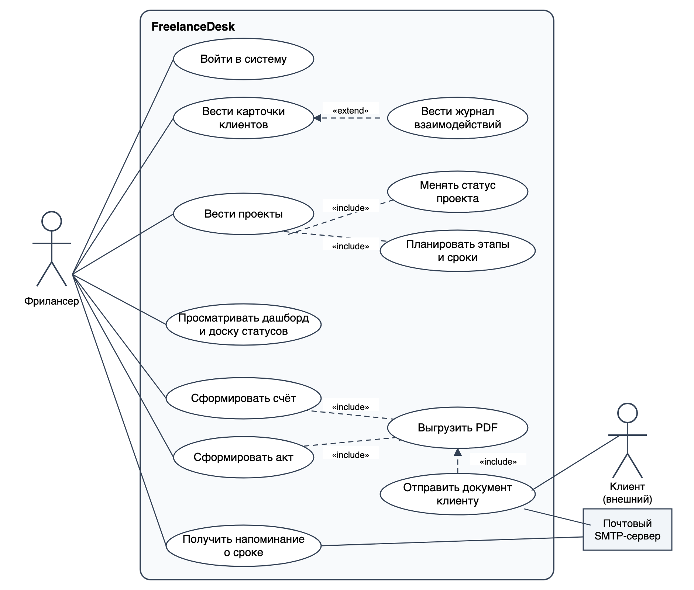
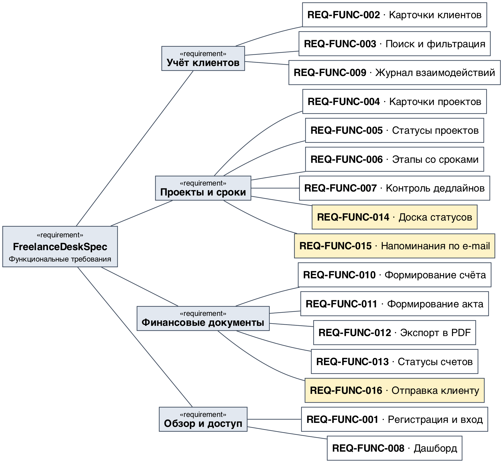
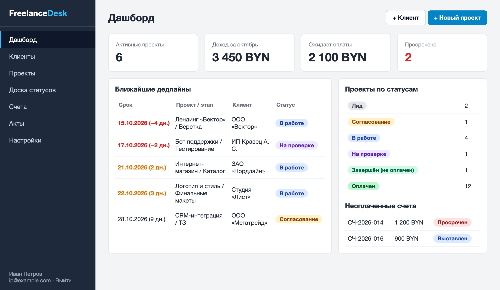
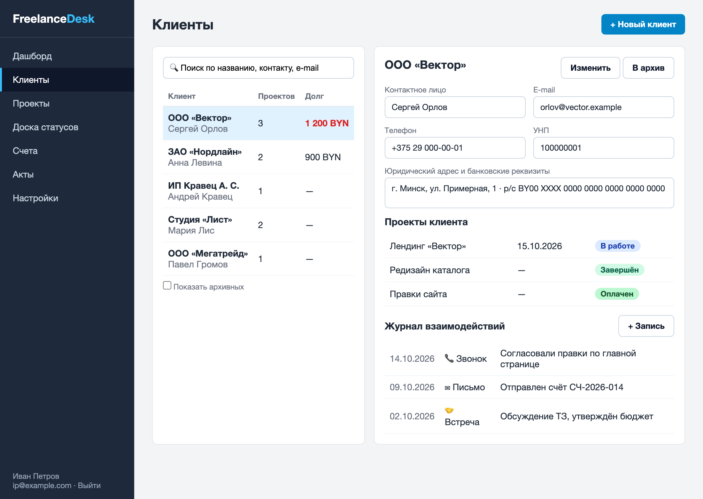
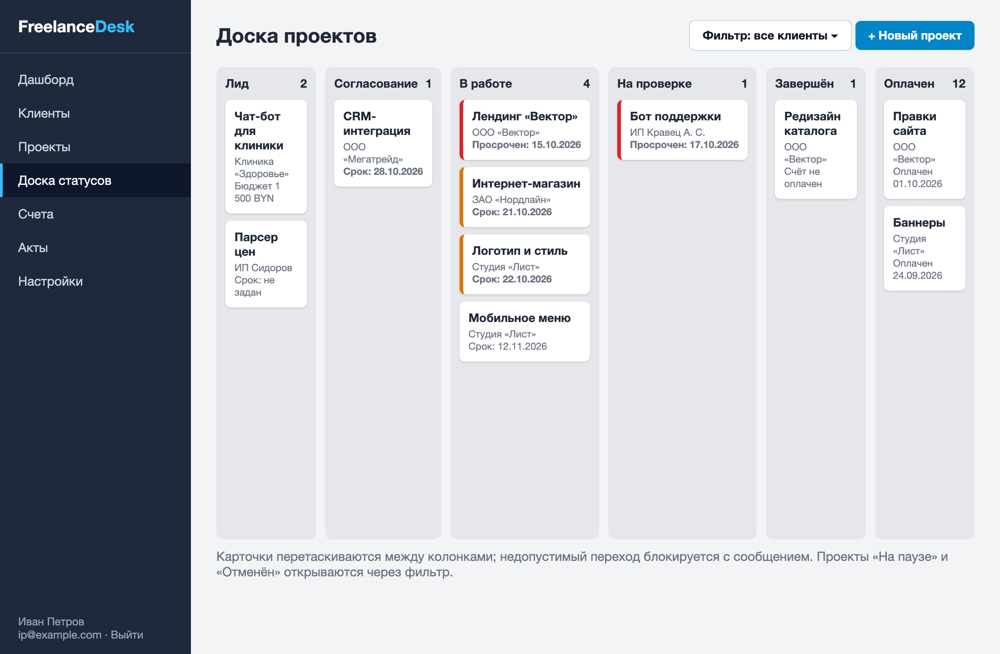
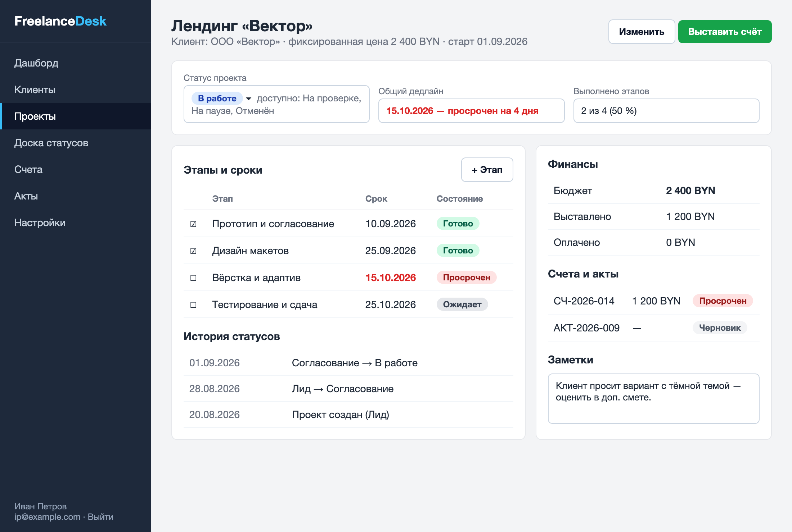
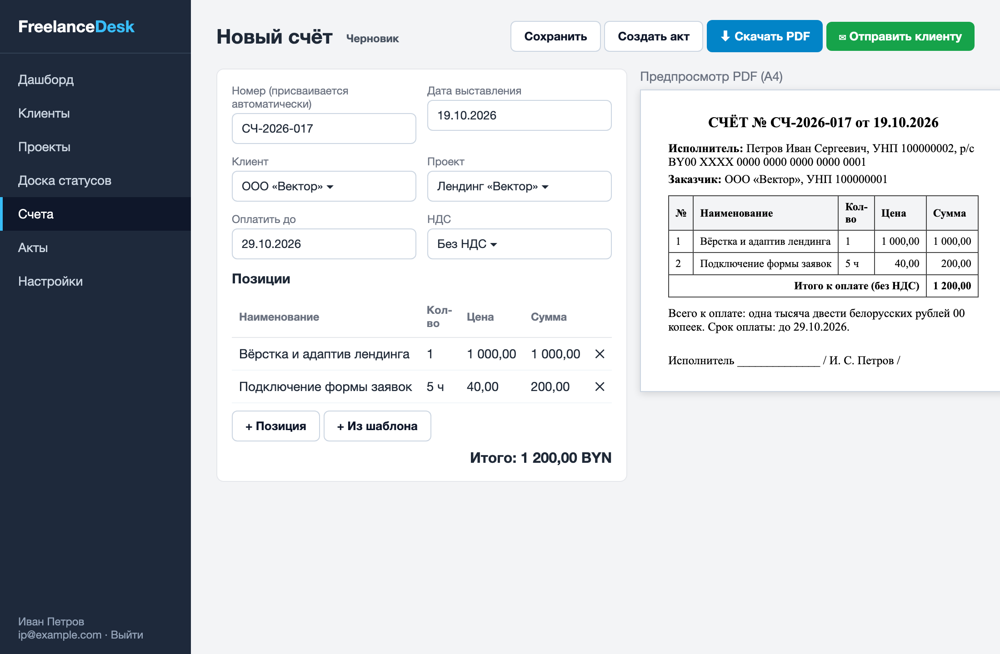
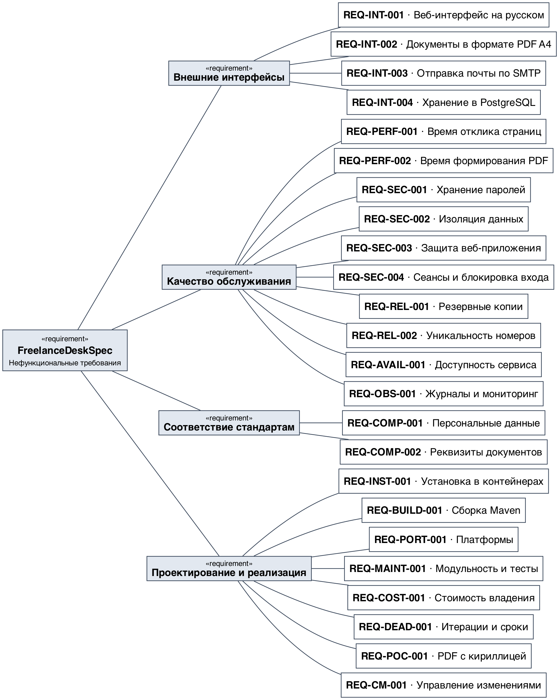
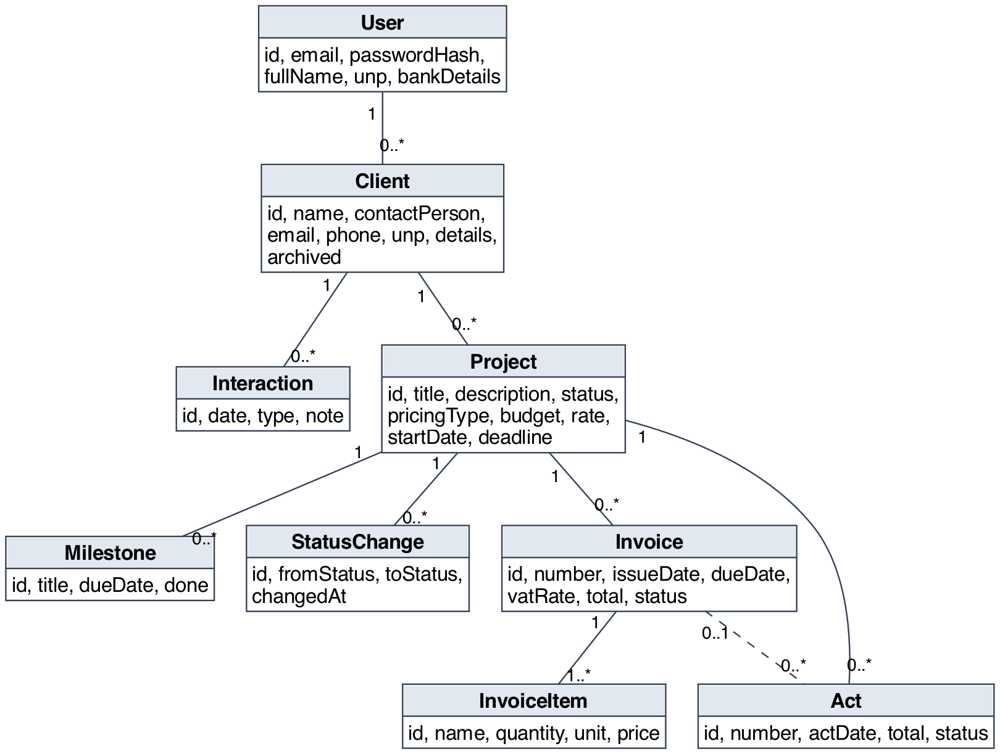

# Спецификация требований к ПО

Для **FreelanceDesk** — CRM-трекера для фрилансера с управлением проектами

Версия 0.2

Подготовил Могильный В. А., группа 450503

Белорусский государственный университет информатики и радиоэлектроники, кафедра электронных вычислительных машин

19.10.2026

## Оглавление

* [1. Введение](#1-введение)
* [2. Обзор продукта](#2-обзор-продукта)
* [3. Требования](#3-требования)
  * [3.1 Внешние интерфейсы](#31-внешние-интерфейсы)
  * [3.2 Функциональные требования](#32-функциональные-требования)
  * [3.3 Качество обслуживания](#33-качество-обслуживания)
  * [3.4 Соответствие стандартам](#34-соответствие-стандартам)
  * [3.5 Проектирование и реализация](#35-проектирование-и-реализация)
  * [3.6 ИИ/МО](#36-иимо)
* [4. Верификация](#4-верификация)
* [5. Приложения](#5-приложения)

## История изменений

| Name | Date | Reason For Changes | Version |
|------|------|--------------------|---------|
| Могильный В. А. | 19.10.2026 | Первая версия: интервью с заказчиком, функциональные и нефункциональные требования, мокапы, диаграммы SysML v2 | 0.1 |
| Могильный В. А. | по итогам рецензии | Добавлены REQ-FUNC-014, REQ-FUNC-015, REQ-FUNC-016; два замечания отклонены (см. 2.6 и приложение А) | 0.2 |

---

## 1. Введение

Документ описывает требования к веб-приложению **FreelanceDesk** — системе учёта клиентов, статусов проектов и дедлайнов с формированием простых счетов и актов выполненных работ. Раздел 2 даёт общий контекст, раздел 3 содержит проверяемые требования, раздел 4 — матрицу верификации, раздел 5 — приложения.

### 1.1 Назначение документа

SRS определяет, **что** система должна делать, но не **как** она будет построена. Документ предназначен для разработчика (студент, он же менеджер проекта), заказчика (напарник по ролевой игре, затем преподаватель), будущих тестировщиков и рецензентов. Проектные решения вынесены в документ проектирования (SDD) и записи архитектурных решений (ADR) следующих лабораторных работ.

### 1.2 Область применения продукта

Продукт — FreelanceDesk, версия 1.0 (учебный проект по дисциплине «Жизненный цикл разработки программного обеспечения»).

Фрилансер ведёт заказы в таблицах, мессенджерах и заметках, из-за чего теряет сроки, забывает выставить счёт и тратит время на оформление документов. FreelanceDesk собирает это в одном веб-приложении:

- учёт клиентов и истории общения с ними;
- учёт проектов, их статусов, этапов и дедлайнов;
- формирование счетов и актов выполненных работ в PDF;
- сводка по текущей загрузке, срокам и неоплаченным счетам.

**Бизнес-цели:**

- БЦ-1 — сократить число пропущенных сроков (цель: не более 5 % проектов с просрочкой по итогам квартала);
- БЦ-2 — сократить время подготовки счёта или акта до 3 минут;
- БЦ-3 — не допускать «забытых» неоплаченных счетов (все выставленные и просроченные счета видны на дашборде).

**Входит в версию 1.0:** один пользователь на учётную запись (фрилансер), клиенты, проекты, статусы, этапы, дедлайны, журнал взаимодействий, счета, акты, PDF, дашборд, доска статусов, напоминания и отправка документов по e-mail.

**Не входит в версию 1.0:** личный кабинет клиента, онлайн-оплата, учёт рабочего времени (таймер), командная работа нескольких исполнителей над одним проектом, мобильное приложение, электронный счёт-фактура (ЭСЧФ) и интеграция с бухгалтерскими системами.

### 1.3 Определения, акронимы и сокращения

| Term | Definition |
|------|------------|
| Акт | Акт выполненных работ — документ, подтверждающий выполнение работ по проекту и их стоимость |
| Дедлайн | Крайний срок сдачи проекта или этапа |
| Доска статусов | Представление проектов в виде колонок по статусам (канбан) |
| Клиент | Заказчик фрилансера (организация или физическое лицо), не являющийся пользователем системы |
| Фрилансер | Пользователь системы, исполнитель проектов |
| Счёт | Документ с перечнем позиций и суммой к оплате |
| Этап | Часть проекта со своим сроком (контрольная точка) |
| УНП | Учётный номер плательщика |
| CRM | Customer Relationship Management — управление взаимоотношениями с клиентами |
| MoSCoW | Метод приоритизации: Must, Should, Could, Won't |
| REST, SMTP | Прикладные протоколы обмена данными и отправки почты |
| SRS | Software Requirements Specification — спецификация требований к ПО |
| SysML v2 | Systems Modeling Language, версия 2 — язык моделирования систем |
| UI | User Interface — пользовательский интерфейс |

### 1.4 Ссылки

| Источник | Тип | Расположение |
|----------|-----|--------------|
| ISO/IEC/IEEE 29148:2018. Systems and software engineering — Life cycle processes — Requirements engineering | нормативная | — |
| IEEE 830-1998. Recommended Practice for Software Requirements Specifications | справочная | — |
| Шаблон SRS кафедры ЭВМ БГУИР | нормативная | `srs/srs-template.md` |
| Лабораторная работа № 3 «Разработка и документирование бизнес-требований» | нормативная | методические указания кафедры |
| Закон Республики Беларусь от 7 мая 2021 г. № 99-З «О защите персональных данных» | нормативная | pravo.by |
| Закон Республики Беларусь от 12 июля 2013 г. № 57-З «О бухгалтерском учёте и отчётности» | справочная | pravo.by |
| SysML v2 — файл с моделью требований | справочная | `srs/sysml/freelancedesk.sysml` |

### 1.5 Обзор документа

Раздел 2 описывает продукт, пользователей, ограничения и допущения. Раздел 3 содержит требования с идентификаторами вида `REQ-[AREA]-[NNN]`, ключевые слова «должен» (обязательное), «следует» (желательное), «может» (допустимое). Приоритет функциональных требований задан по MoSCoW. Раздел 4 связывает требования со способами проверки. Любое изменение требования фиксируется в истории изменений и повышает версию документа.

---

## 2. Обзор продукта

### 2.1 Перспектива продукта

FreelanceDesk — новый самостоятельный продукт. Он заменяет связку «таблица Excel + заметки + текстовые шаблоны счетов». Система состоит из веб-приложения на Java и реляционной базы данных; из внешних систем использует только почтовый SMTP-сервер (для необязательных функций). Владелец и единственный пользователь учебной версии — разработчик. На рисунке 1 показаны участники и варианты использования.

### 2.2 Функции продукта

- учёт клиентов с реквизитами и журналом взаимодействий;
- учёт проектов: тип оплаты, бюджет, сроки;
- управление статусами проекта с проверкой допустимых переходов и историей;
- этапы проекта и контроль дедлайнов с цветовой индикацией;
- дашборд и доска статусов;
- счета и акты с автоматической нумерацией, экспорт в PDF;
- напоминания о сроках и отправка документов клиенту по e-mail.

Иерархия функциональных требований показана на рисунке 2 (светло-жёлтым выделены требования, добавленные в версии 0.2).

### 2.3 Ограничения продукта

- Продукт должен быть веб-приложением на языке Java (Java Web); версия JDK не ниже 21.
- Продукт должен использовать реляционную СУБД PostgreSQL (для автотестов допускается H2).
- Продукт должен использовать только программное обеспечение с открытой лицензией.
- Интерфейс должен быть на русском языке.
- Данные должны храниться на сервере, развёрнутом самим фрилансером; передача данных третьим сторонам запрещена, кроме отправки документов клиенту по инициативе пользователя.

### 2.4 Характеристики пользователей

| Класс пользователей | Описание | Частота работы | Права |
|---------------------|----------|----------------|-------|
| Фрилансер | Разработчик, дизайнер, копирайтер или другой специалист; ведёт 3–15 одновременных проектов; уверенный пользователь ПК, технической подготовки не требуется | Ежедневно, сеансы по 5–20 минут | Полный доступ к собственным данным |
| Клиент | Заказчик фрилансера; в системе не работает, получает PDF-документы | Не применимо | Нет |
| Администратор | Отдельная роль не предусмотрена; развёртыванием занимается сам фрилансер | Не применимо | Нет |

Требования доступности: контраст текста не ниже 4,5:1, управление основными действиями с клавиатуры.

### 2.5 Допущения и зависимости

| Допущение / зависимость | Влияние при невыполнении |
|-------------------------|--------------------------|
| Пользователь работает в одной часовой зоне (Europe/Minsk) | Сроки могут смещаться на сутки; потребуется хранение часового пояса |
| Валюта по умолчанию — BYN; допускаются USD, EUR, RUB без пересчёта курсов | При необходимости пересчёта потребуется интеграция с источником курсов |
| Доступен SMTP-сервер (REQ-FUNC-015, REQ-FUNC-016) | Эти функции недоступны; остальные работают без изменений |
| Используемые библиотеки (Spring, OpenPDF, Flyway) совместимы с JDK 21 | Потребуется замена библиотек |
| Объём данных одного пользователя не превышает 200 клиентов и 500 проектов | Потребуется пересмотр REQ-PERF-001 |

### 2.6 Распределение требований

| Итерация | Модуль | Требования |
|----------|--------|------------|
| 1 | Доступ, клиенты, проекты | REQ-FUNC-001, 002, 003, 004, 005, 006, 007 |
| 2 | Финансовые документы, обзор | REQ-FUNC-008, 009, 010, 011, 012, 013 |
| 3 | Доска, уведомления | REQ-FUNC-014, 015, 016 |
| 1–3 | Нефункциональные | REQ-INT, PERF, SEC, REL, AVAIL, OBS, COMP, INST, BUILD, PORT, MAINT, COST, DEAD, POC, CM |

**Результат рецензирования (версия 0.2).** Принято: канбан-доска (REQ-FUNC-014), напоминания по e-mail (REQ-FUNC-015), отправка документов клиенту по e-mail (REQ-FUNC-016). Отклонено: онлайн-оплата счетов (требует платёжного шлюза и юридических процедур, противоречит ограничению «без сторонних сервисов» и выходит за срок курса); мобильное приложение (адаптивный веб-интерфейс по REQ-INT-001 закрывает потребность).

---

## 3. Требования

### 3.1 Внешние интерфейсы

#### 3.1.1 Пользовательские интерфейсы

Интерфейс состоит из боковой навигации (Дашборд, Клиенты, Проекты, Доска статусов, Счета, Акты, Настройки) и рабочей области. Просроченные сроки выделяются красным, приближающиеся — оранжевым; цвет всегда дублируется текстом. Для пустых списков показывается подсказка с кнопкой создания записи; ошибки ввода показываются рядом с полем.

Мокапы экранов:

Исходники мокапов (HTML) лежат в `srs/mockups/`.

- **ID:** REQ-INT-001
- **Title:** Русскоязычный адаптивный веб-интерфейс
- **Statement:** Система должна предоставлять интерфейс на русском языке, корректно отображаемый при ширине окна от 360 до 1920 пикселей.
- **Rationale:** Фрилансер должен иметь возможность быстро открыть систему и с телефона.
- **Acceptance Criteria:** Все экраны из рисунков 3–7 открываются без горизонтальной прокрутки при ширине 360 пикселей.
- **Verification Method:** Inspection
- **More Information:** Рисунки 3–7.

#### 3.1.2 Аппаратные интерфейсы

Специальные аппаратные интерфейсы не требуются. Система работает на любом сервере или компьютере с поддержкой Java 21 и не менее 2 ГБ оперативной памяти.

#### 3.1.3 Программные интерфейсы

- **ID:** REQ-INT-002
- **Title:** Документы в формате PDF
- **Statement:** Система должна формировать счета и акты в формате PDF на листе A4 с шрифтом, содержащим кириллические символы.
- **Rationale:** Клиент ожидает привычный печатный документ.
- **Acceptance Criteria:** В сформированном файле без искажений отображаются символы «ё», «№», ««»».
- **Verification Method:** Test
- **More Information:** REQ-POC-001.

- **ID:** REQ-INT-003
- **Title:** Отправка почты по SMTP
- **Statement:** Система может отправлять письма через SMTP-сервер, параметры которого (адрес, порт, логин, пароль, шифрование) задаются в конфигурации окружения.
- **Rationale:** Нужна для напоминаний и отправки документов.
- **Acceptance Criteria:** При недоступном SMTP-сервере пользователь видит сообщение об ошибке, остальные функции продолжают работать.
- **Verification Method:** Test
- **More Information:** REQ-FUNC-015, REQ-FUNC-016.

- **ID:** REQ-INT-004
- **Title:** Хранение данных в PostgreSQL
- **Statement:** Система должна хранить данные в реляционной базе PostgreSQL версии не ниже 15, схема создаётся и изменяется скриптами миграций.
- **Rationale:** Нужны транзакции и ограничения целостности для нумерации документов.
- **Acceptance Criteria:** На пустой базе приложение самостоятельно создаёт схему при первом запуске.
- **Verification Method:** Test
- **More Information:** Модель данных — рисунок А.1.

### 3.2 Функциональные требования

Модель данных, на которую опираются требования, приведена в приложении Б.

#### 3.2.1 Доступ

- **ID:** REQ-FUNC-001
- **Title:** Регистрация и вход
- **Statement:** Система должна позволять фрилансеру зарегистрироваться (e-mail, пароль не короче 8 символов, ФИО, УНП, банковские реквизиты), войти, выйти и сменить пароль.
- **Rationale:** Данные клиентов и финансов не должны быть общедоступными.
- **Acceptance Criteria:** Повторная регистрация с тем же e-mail отклоняется; без входа все страницы, кроме входа и регистрации, недоступны.
- **Verification Method:** Test
- **More Information:** Приоритет Must. REQ-SEC-001, REQ-SEC-004.

#### 3.2.2 Клиенты

- **ID:** REQ-FUNC-002
- **Title:** Карточки клиентов
- **Statement:** Система должна позволять создавать, изменять и архивировать карточку клиента: название, контактное лицо, e-mail, телефон, УНП, юридический адрес и банковские реквизиты, заметки. Клиента с проектами удалять запрещено, допускается только архивирование.
- **Rationale:** Реквизиты клиента подставляются в счета и акты.
- **Acceptance Criteria:** Архивный клиент не предлагается при создании проекта и скрыт из списка по умолчанию; попытка удалить клиента с проектами возвращает сообщение об отказе.
- **Verification Method:** Test
- **More Information:** Приоритет Must. Рисунок 4.

- **ID:** REQ-FUNC-003
- **Title:** Поиск и фильтрация
- **Statement:** Система должна выполнять поиск клиентов по названию, контактному лицу и e-mail, а проектов — фильтрацию по статусу, клиенту и сроку.
- **Rationale:** При десятках записей прокрутка списка неудобна.
- **Acceptance Criteria:** Поиск без учёта регистра; результат появляется не позднее 1 секунды после ввода.
- **Verification Method:** Test
- **More Information:** Приоритет Should.

- **ID:** REQ-FUNC-009
- **Title:** Журнал взаимодействий
- **Statement:** Система должна хранить для клиента записи журнала: дата, тип (звонок, письмо, встреча, другое), текст заметки, и показывать их в порядке убывания даты.
- **Rationale:** Фрилансеру нужно помнить договорённости.
- **Acceptance Criteria:** Запись можно добавить, изменить и удалить; журнал отображается в карточке клиента.
- **Verification Method:** Demonstration
- **More Information:** Приоритет Should. Рисунок 4.

#### 3.2.3 Проекты и сроки

- **ID:** REQ-FUNC-004
- **Title:** Карточки проектов
- **Statement:** Система должна позволять создавать и изменять проект: название, клиент, описание, тип оплаты (фиксированная цена или почасовая ставка), бюджет или ставка, валюта, дата начала, дедлайн.
- **Rationale:** Проект — основная учётная единица.
- **Acceptance Criteria:** Дедлайн не может быть раньше даты начала; для типа «фиксированная цена» обязателен бюджет, для «почасовая» — ставка.
- **Verification Method:** Test
- **More Information:** Приоритет Must. Рисунок 6.

- **ID:** REQ-FUNC-005
- **Title:** Статусы проектов
- **Statement:** Система должна присваивать проекту один из статусов: «Лид», «Согласование», «В работе», «На проверке», «Завершён», «Оплачен», «На паузе», «Отменён» — и допускать только переходы, указанные в таблице 1; каждый переход должен записываться в историю с датой и временем.
- **Rationale:** Формальные статусы исключают путаницу в том, какие проекты активны и какие ожидают оплаты.
- **Acceptance Criteria:** Недопустимый переход отклоняется с сообщением; история статусов отображается в карточке проекта; новый проект получает статус «Лид».
- **Verification Method:** Test
- **More Information:** Приоритет Must.

Таблица 1 – Допустимые переходы статусов проекта

| Из статуса | В статус |
|------------|----------|
| Лид | Согласование, Отменён |
| Согласование | В работе, Отменён |
| В работе | На проверке, На паузе, Отменён |
| На проверке | В работе, Завершён |
| Завершён | Оплачен |
| На паузе | В работе, Отменён |
| Оплачен | — (конечный) |
| Отменён | — (конечный) |

- **ID:** REQ-FUNC-006
- **Title:** Этапы проекта
- **Statement:** Система должна позволять добавлять к проекту этапы с названием и сроком, отмечать этап выполненным и показывать долю выполненных этапов.
- **Rationale:** Крупные заказы нужно контролировать по частям.
- **Acceptance Criteria:** При сроке этапа позже дедлайна проекта пользователь получает предупреждение, но может сохранить этап.
- **Verification Method:** Test
- **More Information:** Приоритет Must. Рисунок 6.

- **ID:** REQ-FUNC-007
- **Title:** Контроль дедлайнов
- **Statement:** Система должна считать срок просроченным, если он раньше текущей даты, а проект или этап не завершён, и «приближающимся», если до него осталось не более N дней (по умолчанию 3, настраивается от 1 до 14), и выделять такие сроки в списках, на доске, в карточке проекта и на дашборде.
- **Rationale:** Главная цель продукта — не пропускать сроки (БЦ-1).
- **Acceptance Criteria:** На тестовых данных все просроченные и приближающиеся сроки выделены; проекты со статусами «Оплачен» и «Отменён» не помечаются.
- **Verification Method:** Test
- **More Information:** Приоритет Must.

- **ID:** REQ-FUNC-014
- **Title:** Доска статусов
- **Statement:** Система должна показывать проекты в виде колонок по статусам и позволять менять статус перетаскиванием карточки с применением правил REQ-FUNC-005.
- **Rationale:** Добавлено по замечанию заказчика (версия 0.2): наглядная загрузка.
- **Acceptance Criteria:** Перетаскивание на допустимую колонку меняет статус; на недопустимую — карточка возвращается и показывается сообщение.
- **Verification Method:** Demonstration
- **More Information:** Приоритет Should. Рисунок 5.

- **ID:** REQ-FUNC-015
- **Title:** Напоминания о сроках
- **Statement:** Система может отправлять фрилансеру на e-mail напоминание о сроках проектов и этапов за N дней (см. REQ-FUNC-007) и в день срока, не более одного письма в сутки на пользователя.
- **Rationale:** Добавлено по замечанию заказчика (версия 0.2): сроки не должны зависеть от того, открыт ли сайт.
- **Acceptance Criteria:** При наличии подходящих сроков в 09:00 по Europe/Minsk отправляется одно письмо со списком; при отсутствии сроков письмо не отправляется.
- **Verification Method:** Test
- **More Information:** Приоритет Could. Зависит от REQ-INT-003.

#### 3.2.4 Финансовые документы

- **ID:** REQ-FUNC-010
- **Title:** Формирование счёта
- **Statement:** Система должна формировать счёт для проекта: автоматический номер вида СЧ-ГГГГ-NNN, дата выставления, срок оплаты, клиент, позиции (наименование, количество, единица, цена), НДС (без НДС или ставка из настроек), итоговая сумма цифрами и прописью.
- **Rationale:** БЦ-2.
- **Acceptance Criteria:** Сумма счёта равна сумме позиций с учётом НДС с точностью до копейки; номер присваивается автоматически и не редактируется.
- **Verification Method:** Test
- **More Information:** Приоритет Must. Рисунок 7.

- **ID:** REQ-FUNC-011
- **Title:** Формирование акта
- **Statement:** Система должна формировать акт выполненных работ на основании счёта или проекта: автоматический номер вида АКТ-ГГГГ-NNN, дата, перечень работ, итоговая сумма, места для подписей сторон.
- **Rationale:** Акт подтверждает приёмку работ клиентом.
- **Acceptance Criteria:** Позиции акта, созданного из счёта, совпадают с позициями счёта.
- **Verification Method:** Test
- **More Information:** Приоритет Must.

- **ID:** REQ-FUNC-012
- **Title:** Экспорт в PDF
- **Statement:** Система должна выгружать счёт и акт в формате PDF по требованию пользователя.
- **Rationale:** Документ передаётся клиенту в виде файла.
- **Acceptance Criteria:** PDF содержит те же данные, что и экранная форма; формирование занимает не более времени, указанного в REQ-PERF-002.
- **Verification Method:** Test
- **More Information:** Приоритет Must. REQ-INT-002.

- **ID:** REQ-FUNC-013
- **Title:** Статусы счетов и учёт оплат
- **Statement:** Система должна присваивать счёту статус «Черновик», «Выставлен», «Оплачен» или «Просрочен», позволять отмечать оплату с датой и автоматически переводить выставленный счёт в «Просрочен» после даты оплаты. Выставленный счёт редактировать запрещено.
- **Rationale:** БЦ-3: неоплаченные счета должны быть видны.
- **Acceptance Criteria:** Статус «Просрочен» устанавливается не позднее следующих суток после срока оплаты; попытка изменить позиции выставленного счёта отклоняется.
- **Verification Method:** Test
- **More Information:** Приоритет Should.

- **ID:** REQ-FUNC-016
- **Title:** Отправка документов клиенту
- **Statement:** Система может отправлять счёт или акт в формате PDF на e-mail клиента из карточки документа и записывать отправку в журнал взаимодействий.
- **Rationale:** Добавлено по замечанию заказчика (версия 0.2): не прикладывать файл вручную.
- **Acceptance Criteria:** Клиент получает письмо с вложением; запись о письме появляется в журнале взаимодействий.
- **Verification Method:** Demonstration
- **More Information:** Приоритет Could. Зависит от REQ-INT-003, REQ-FUNC-009.

#### 3.2.5 Обзор

- **ID:** REQ-FUNC-008
- **Title:** Дашборд
- **Statement:** Система должна показывать на главной странице: число активных проектов (статусы «Согласование», «В работе», «На проверке»), доход за текущий месяц по оплаченным счетам, сумму выставленных неоплаченных счетов, число проектов с просроченными сроками, пять ближайших сроков, распределение проектов по статусам и список неоплаченных счетов.
- **Rationale:** Фрилансер должен видеть общую картину за несколько секунд.
- **Acceptance Criteria:** Показатели совпадают с данными списков при сверке на тестовом наборе.
- **Verification Method:** Test
- **More Information:** Приоритет Should. Рисунок 3.

### 3.3 Качество обслуживания

Иерархия нефункциональных требований показана на рисунке 8.

#### 3.3.1 Производительность

- **ID:** REQ-PERF-001
- **Title:** Время отклика страниц
- **Statement:** Страницы списков, карточек и дашборд должны открываться не более чем за 1,5 секунды для 95 % запросов при 200 клиентах, 500 проектах и пяти одновременных запросах на сервере с двумя vCPU и 2 ГБ памяти.
- **Rationale:** Интерфейс не должен мешать работе.
- **Acceptance Criteria:** Нагрузочный прогон на тестовых данных показывает 95-й процентиль не более 1,5 секунды.
- **Verification Method:** Test
- **More Information:** —

- **ID:** REQ-PERF-002
- **Title:** Время формирования PDF
- **Statement:** Формирование PDF-документа до 30 позиций должно занимать не более 3 секунд для 95 % запросов.
- **Rationale:** БЦ-2.
- **Acceptance Criteria:** Замер на 100 запросах: 95-й процентиль не более 3 секунд.
- **Verification Method:** Test
- **More Information:** —

#### 3.3.2 Безопасность

- **ID:** REQ-SEC-001
- **Title:** Хранение паролей
- **Statement:** Пароли должны храниться только в виде хэша bcrypt со стоимостью не менее 10.
- **Rationale:** Защита при утечке базы.
- **Acceptance Criteria:** В таблице пользователей нет открытых паролей; формат хэша — bcrypt.
- **Verification Method:** Inspection
- **More Information:** —

- **ID:** REQ-SEC-002
- **Title:** Изоляция данных
- **Statement:** Система должна предоставлять пользователю только его собственные клиентов, проекты, счета и акты; обращение к чужой записи по идентификатору должно возвращать ответ «не найдено».
- **Rationale:** Данные клиентов конфиденциальны.
- **Acceptance Criteria:** Автотест: пользователь B не получает записей пользователя A ни одним из маршрутов.
- **Verification Method:** Test
- **More Information:** —

- **ID:** REQ-SEC-003
- **Title:** Защита веб-приложения
- **Statement:** Система должна работать по HTTPS, защищать формы от подделки межсайтовых запросов, экранировать выводимые данные и использовать параметризованные запросы к базе.
- **Rationale:** Типовые атаки на веб-приложения.
- **Acceptance Criteria:** Форма без токена отклоняется; введённый в поле текст `<script>` отображается как текст; автоматическая проверка зависимостей не находит критических уязвимостей.
- **Verification Method:** Test
- **More Information:** —

- **ID:** REQ-SEC-004
- **Title:** Сеансы и блокировка входа
- **Statement:** Сеанс должен завершаться после 30 минут бездействия; после пяти подряд неудачных попыток входа вход для этой учётной записи должен блокироваться на 15 минут.
- **Rationale:** Защита от подбора пароля и чужого доступа.
- **Acceptance Criteria:** Шестая попытка после пяти неудачных отклоняется даже при верном пароле.
- **Verification Method:** Test
- **More Information:** —

#### 3.3.3 Надёжность

- **ID:** REQ-REL-001
- **Title:** Резервное копирование
- **Statement:** Система должна обеспечивать ежедневное резервное копирование базы данных с хранением семи последних копий и описанной процедурой восстановления.
- **Rationale:** Потеря данных о клиентах и счетах недопустима.
- **Acceptance Criteria:** Восстановление из копии на чистой базе проходит успешно и возвращает данные предыдущих суток.
- **Verification Method:** Demonstration
- **More Information:** —

- **ID:** REQ-REL-002
- **Title:** Уникальность номеров документов
- **Statement:** Номера счетов и актов должны быть уникальными в пределах пользователя и года, без пропусков; уникальность должна обеспечиваться базой данных.
- **Rationale:** Нумерация первичных документов должна быть сквозной.
- **Acceptance Criteria:** При 50 параллельных созданиях счетов номера не повторяются и идут подряд.
- **Verification Method:** Test
- **More Information:** REQ-FUNC-010, REQ-FUNC-011.

#### 3.3.4 Доступность

- **ID:** REQ-AVAIL-001
- **Title:** Доступность сервиса
- **Statement:** Сервис должен быть доступен не менее 99 % времени в месяц (не более 7,3 часа простоя); плановые работы должны выполняться с 02:00 до 05:00 по Europe/Minsk.
- **Rationale:** Фрилансер обращается к системе в разное время суток.
- **Acceptance Criteria:** По журналу проверок состояния за месяц суммарный простой не превышает 7,3 часа.
- **Verification Method:** Analysis
- **More Information:** —

#### 3.3.5 Наблюдаемость

- **ID:** REQ-OBS-001
- **Title:** Журналы и проверка состояния
- **Statement:** Система должна вести журнал событий в структурированном формате (JSON) с уровнями ERROR, WARN, INFO и предоставлять конечную точку проверки состояния; пароли и персональные данные клиентов в журнал попадать не должны.
- **Rationale:** Нужна диагностика без раскрытия данных.
- **Acceptance Criteria:** В журнале за тестовый сеанс нет паролей и e-mail клиентов; запрос состояния возвращает «UP».
- **Verification Method:** Inspection
- **More Information:** —

### 3.4 Соответствие стандартам

- **ID:** REQ-COMP-001
- **Title:** Защита персональных данных
- **Statement:** Система должна хранить только данные клиентов, необходимые для работы, позволять выгрузить и удалить все данные пользователя по его запросу, а при удалении учётной записи удалять связанные персональные данные клиентов.
- **Rationale:** Закон Республики Беларусь № 99-З «О защите персональных данных».
- **Acceptance Criteria:** После удаления учётной записи в базе не остаётся записей, принадлежащих этому пользователю.
- **Verification Method:** Test
- **More Information:** Раздел 1.4.

- **ID:** REQ-COMP-002
- **Title:** Реквизиты первичных документов
- **Statement:** Счёт и акт должны содержать наименование документа, номер, дату, УНП и наименования сторон, содержание операции, стоимость и места для подписей. Документы не заменяют электронный счёт-фактуру (ЭСЧФ).
- **Rationale:** Закон Республики Беларусь № 57-З «О бухгалтерском учёте и отчётности» (актуальность редакции проверить при реализации).
- **Acceptance Criteria:** Инспекция образца PDF подтверждает наличие всех перечисленных реквизитов.
- **Verification Method:** Inspection
- **More Information:** Рисунок 7.

### 3.5 Проектирование и реализация

#### 3.5.1 Установка

- **ID:** REQ-INST-001
- **Title:** Установка в контейнерах
- **Statement:** Система должна запускаться командой `docker compose up` (приложение и PostgreSQL); параметры (адрес базы, SMTP, секреты) должны задаваться переменными окружения, откат — запуском предыдущего образа.
- **Rationale:** Простая установка для фрилансера без администратора.
- **Acceptance Criteria:** На чистой машине с Docker приложение доступно по адресу `http://localhost:8080` не позднее чем через 2 минуты.
- **Verification Method:** Demonstration
- **More Information:** —

#### 3.5.2 Сборка и поставка

- **ID:** REQ-BUILD-001
- **Title:** Воспроизводимая сборка
- **Statement:** Проект должен собираться командой `mvn package` на JDK 21 с фиксированными версиями зависимостей и выпускаться в виде исполняемого jar-файла и образа контейнера.
- **Rationale:** Воспроизводимость и трассируемость выпусков.
- **Acceptance Criteria:** Сборка на чистом клоне репозитория завершается успешно, тесты проходят.
- **Verification Method:** Test
- **More Information:** —

#### 3.5.3 Распределение

Система развёртывается одним экземпляром приложения и одной базой данных; распределённое развёртывание не требуется.

#### 3.5.4 Сопровождаемость

- **ID:** REQ-MAINT-001
- **Title:** Модульность и тесты
- **Statement:** Код должен быть разделён на слои «веб – сервисы – доступ к данным»; покрытие модульными тестами сервисного слоя должно быть не менее 70 %; код должен проходить проверку стиля Checkstyle.
- **Rationale:** Упрощение развития продукта на следующих лабораторных работах.
- **Acceptance Criteria:** Отчёт покрытия показывает не менее 70 % по сервисному слою.
- **Verification Method:** Analysis
- **More Information:** —

#### 3.5.5 Повторное использование

Отдельных компонентов для повторного использования не выделяется; генерация PDF должна быть вынесена в отдельный сервис для возможной замены библиотеки.

#### 3.5.6 Переносимость

- **ID:** REQ-PORT-001
- **Title:** Платформы и браузеры
- **Statement:** Система должна работать под Linux, macOS и Windows с Java 21 и корректно отображаться в двух последних версиях Chrome, Firefox, Safari и Edge.
- **Rationale:** Пользователи используют разные ОС и браузеры.
- **Acceptance Criteria:** Основные сценарии пройдены вручную в каждом перечисленном браузере.
- **Verification Method:** Demonstration
- **More Information:** —

#### 3.5.7 Стоимость

- **ID:** REQ-COST-001
- **Title:** Стоимость владения
- **Statement:** Система должна строиться только на программном обеспечении с открытой лицензией; стоимость хостинга не должна превышать 10 долларов США в месяц.
- **Rationale:** Целевой пользователь — фрилансер с ограниченным бюджетом.
- **Acceptance Criteria:** Перечень зависимостей содержит только открытые лицензии (Apache-2.0, MIT, LGPL, MPL, PostgreSQL License).
- **Verification Method:** Inspection
- **More Information:** —

#### 3.5.8 Сроки

- **ID:** REQ-DEAD-001
- **Title:** Итерации разработки
- **Statement:** Разработка должна вестись тремя итерациями согласно таблице в разделе 2.6; итерация считается завершённой, если все её требования приоритета Must проверены.
- **Rationale:** Сроки определяются графиком лабораторных работ курса.
- **Acceptance Criteria:** Матрица верификации (раздел 4) по требованиям итерации не содержит строк в статусе «Запланировано».
- **Verification Method:** Inspection
- **More Information:** Календарные даты итераций согласуются с графиком курса.

#### 3.5.9 Доказательство концепции

- **ID:** REQ-POC-001
- **Title:** Проверка формирования PDF с кириллицей
- **Statement:** До начала итерации 2 должен быть выполнен прототип формирования PDF на выбранной библиотеке с кириллическим шрифтом с открытой лицензией.
- **Rationale:** Главный технический риск — корректная кириллица и вёрстка таблицы.
- **Acceptance Criteria:** Тестовый счёт на 30 позиций формируется менее чем за 3 секунды без искажённых символов.
- **Verification Method:** Demonstration
- **More Information:** REQ-INT-002, REQ-PERF-002.

#### 3.5.10 Управление изменениями

- **ID:** REQ-CM-001
- **Title:** Управление изменениями
- **Statement:** Изменения требований и кода должны вноситься через отдельные ветки и запросы на слияние (pull request); изменения схемы базы данных — только скриптами миграций; версия SRS повышается при каждом принятом изменении.
- **Rationale:** Трассируемость изменений.
- **Acceptance Criteria:** В истории репозитория нет прямых коммитов в основную ветку после первого выпуска.
- **Verification Method:** Inspection
- **More Information:** Раздел «История изменений».

### 3.6 ИИ/МО

Не применимо: система не содержит компонентов машинного обучения.

---

## 4. Верификация

| Requirement ID | Verification Method | Test/Artifact Link | Status | Evidence |
|----------------|---------------------|--------------------|--------|----------|
| REQ-FUNC-001 | Test | tests/UC01-auth.md | Запланировано | — |
| REQ-FUNC-002 | Test | tests/UC02-clients.md | Запланировано | — |
| REQ-FUNC-003 | Test | tests/UC02-clients.md | Запланировано | — |
| REQ-FUNC-004 | Test | tests/UC03-projects.md | Запланировано | — |
| REQ-FUNC-005 | Test | tests/UC03-projects.md | Запланировано | — |
| REQ-FUNC-006 | Test | tests/UC03-projects.md | Запланировано | — |
| REQ-FUNC-007 | Test | tests/UC04-deadlines.md | Запланировано | — |
| REQ-FUNC-008 | Test | tests/UC05-dashboard.md | Запланировано | — |
| REQ-FUNC-009 | Demonstration | tests/UC02-clients.md | Запланировано | — |
| REQ-FUNC-010 | Test | tests/UC06-billing.md | Запланировано | — |
| REQ-FUNC-011 | Test | tests/UC06-billing.md | Запланировано | — |
| REQ-FUNC-012 | Test | tests/UC06-billing.md | Запланировано | — |
| REQ-FUNC-013 | Test | tests/UC06-billing.md | Запланировано | — |
| REQ-FUNC-014 | Demonstration | tests/UC07-board.md | Запланировано | — |
| REQ-FUNC-015 | Test | tests/UC08-mail.md | Запланировано | — |
| REQ-FUNC-016 | Demonstration | tests/UC08-mail.md | Запланировано | — |
| REQ-INT-001 | Inspection | tests/ui-checklist.md | Запланировано | — |
| REQ-INT-002 | Test | tests/UC06-billing.md | Запланировано | — |
| REQ-INT-003 | Test | tests/UC08-mail.md | Запланировано | — |
| REQ-INT-004 | Test | tests/migration-test.md | Запланировано | — |
| REQ-PERF-001 | Test | tests/perf-pages.md | Запланировано | — |
| REQ-PERF-002 | Test | tests/perf-pdf.md | Запланировано | — |
| REQ-SEC-001 | Inspection | tests/security-review.md | Запланировано | — |
| REQ-SEC-002 | Test | tests/security-isolation.md | Запланировано | — |
| REQ-SEC-003 | Test | tests/security-review.md | Запланировано | — |
| REQ-SEC-004 | Test | tests/security-session.md | Запланировано | — |
| REQ-REL-001 | Demonstration | tests/backup-restore.md | Запланировано | — |
| REQ-REL-002 | Test | tests/numbering-concurrency.md | Запланировано | — |
| REQ-AVAIL-001 | Analysis | monitoring/uptime-report.md | Запланировано | — |
| REQ-OBS-001 | Inspection | tests/logging-review.md | Запланировано | — |
| REQ-COMP-001 | Test | tests/privacy-delete.md | Запланировано | — |
| REQ-COMP-002 | Inspection | tests/UC06-billing.md | Запланировано | — |
| REQ-INST-001 | Demonstration | docs/install.md | Запланировано | — |
| REQ-BUILD-001 | Test | CI-сборка | Запланировано | — |
| REQ-MAINT-001 | Analysis | отчёт покрытия | Запланировано | — |
| REQ-PORT-001 | Demonstration | tests/browsers.md | Запланировано | — |
| REQ-COST-001 | Inspection | docs/licenses.md | Запланировано | — |
| REQ-DEAD-001 | Inspection | раздел 4 данного документа | Запланировано | — |
| REQ-POC-001 | Demonstration | poc/pdf-cyrillic | Запланировано | — |
| REQ-CM-001 | Inspection | история репозитория | Запланировано | — |

---

## 5. Приложения

### Приложение А. Замечания заказчика и решения

| Замечание | Решение | Обоснование |
|-----------|---------|-------------|
| Добавить доску статусов с перетаскиванием | Принято (REQ-FUNC-014) | Улучшает наглядность загрузки при малой стоимости реализации |
| Присылать напоминания о сроках на e-mail | Принято (REQ-FUNC-015, приоритет Could) | Контроль сроков без открытия сайта |
| Отправлять счёт и акт клиенту из системы | Принято (REQ-FUNC-016, приоритет Could) | Экономия времени, соответствует БЦ-2 |
| Добавить онлайн-оплату счетов | Отклонено | Нужны платёжный шлюз и юридические процедуры, выходит за ограничения и срок курса |
| Сделать мобильное приложение | Отклонено | Адаптивный веб-интерфейс (REQ-INT-001) закрывает потребность |

### Приложение Б. Модель данных

### Приложение В. Файлы модели SysML v2

Текстовая модель требований находится в `srs/sysml/freelancedesk.sysml`, исходные файлы диаграмм — в `srs/sysml/`.
